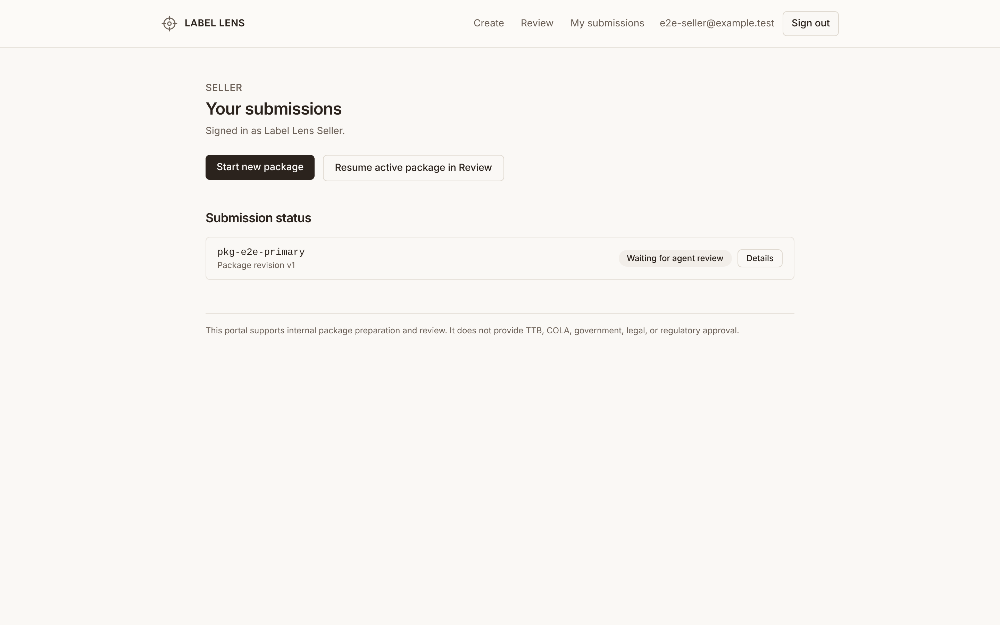
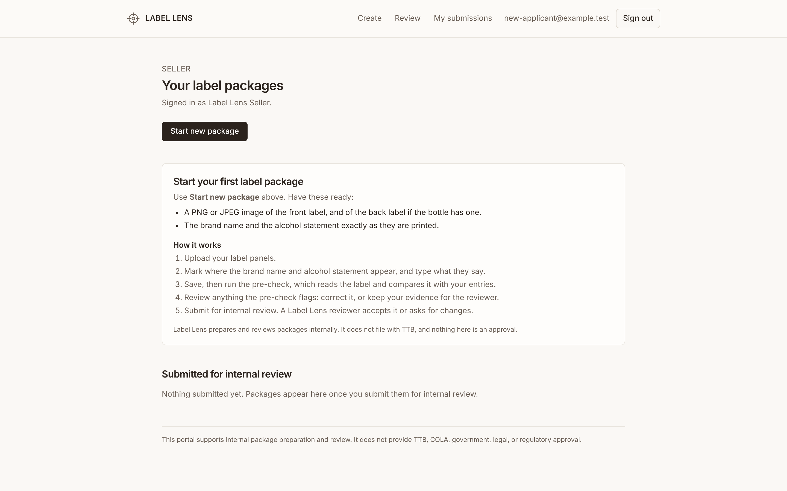
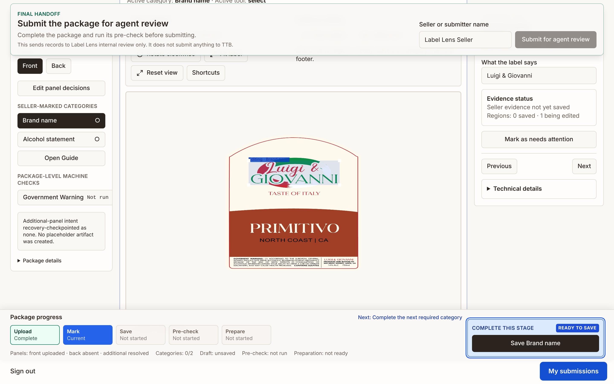
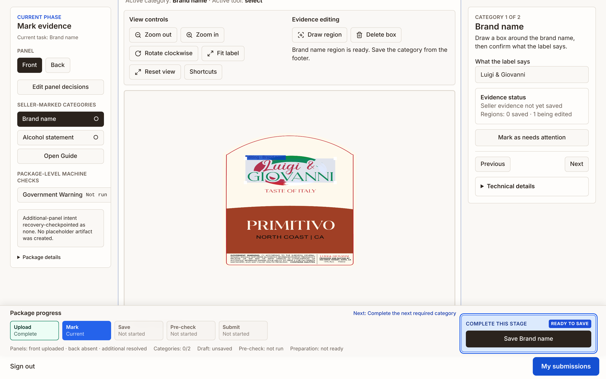
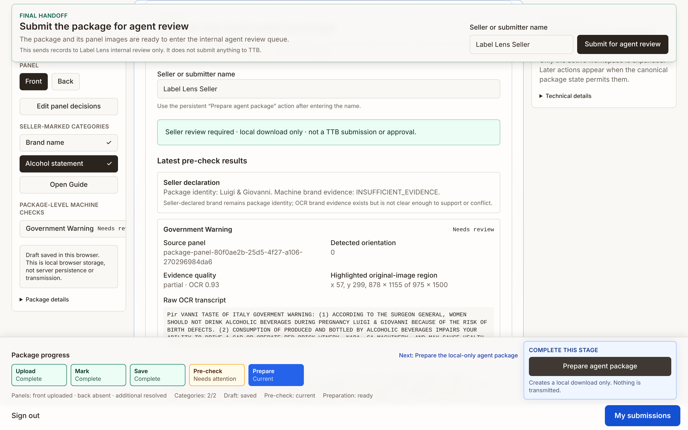
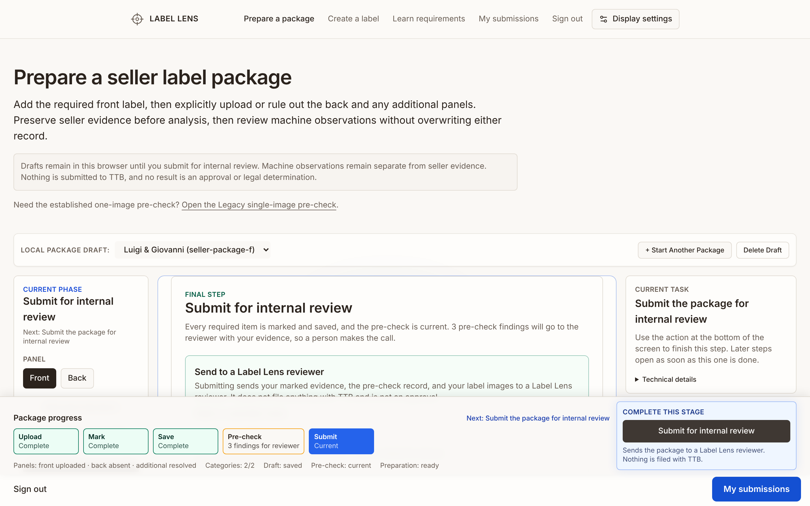
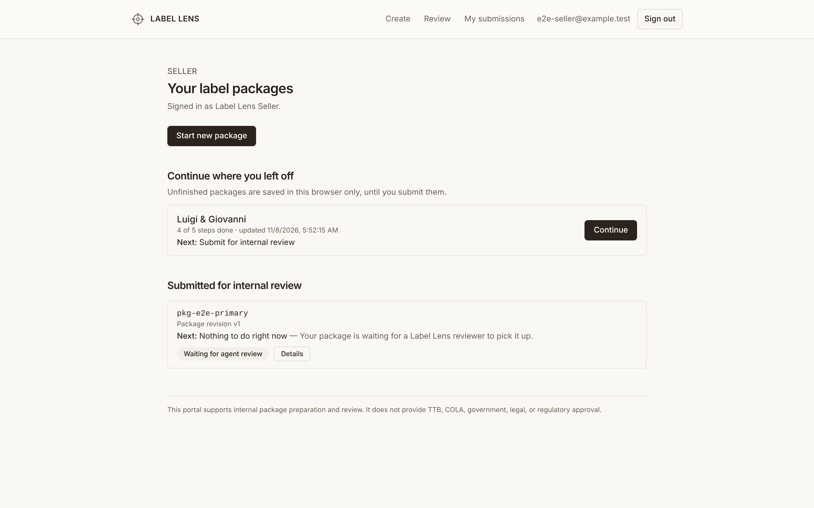
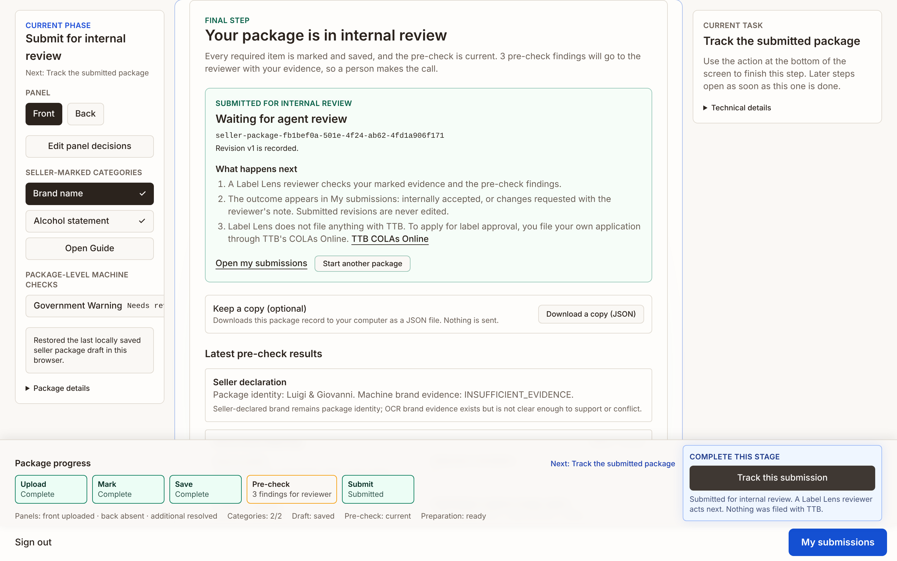
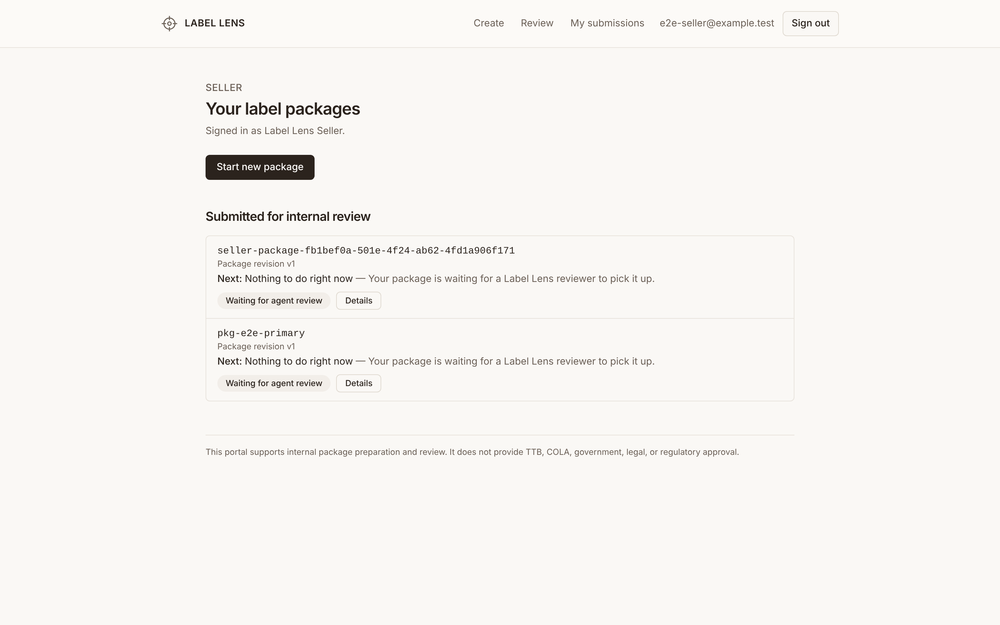
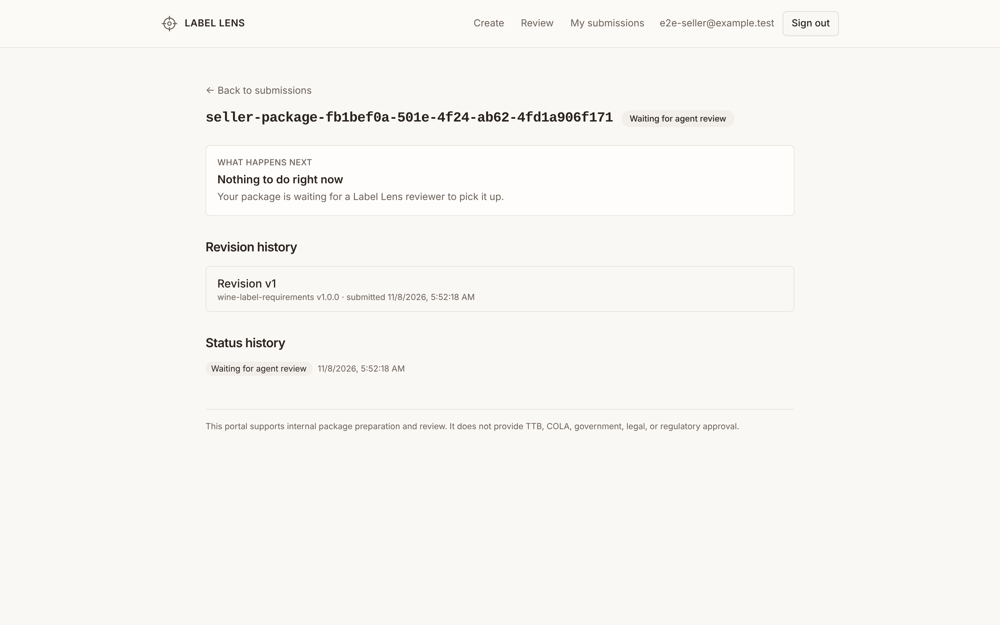

# Issue #226 Block 1: the seller journey ends at internal-review submission

- Date: 2026-11-08
- Scope: the authenticated seller path `/login` → `/seller` → `/review` → `/seller/submissions/[id]`
- Baseline: `main` at `195182c`, local production build (`next build` + `next start`), SQLite e2e seed, Chromium, 1440×900 at device scale 2
- Fixture: `tests/fixtures/precheck/approved-wine-001/label.png`, an author-provided public-registry screenshot of previously approved wine-label artwork (see [the corpus record](../../corpus/approved-wine-110.md)), entered as brand "Luigi & Giovanni" and alcohol statement "14% ALC"

Label Lens is not a TTB system. Nothing in this slice files with TTB, and an internal-review decision is not an approval.

## Click-path reconnaissance on `main`

| Path | State | Observed |
|---|---|---|
| `/` intent hub | Implemented | Four working intents, two honestly marked unavailable. |
| `/login` → `/seller` | Implemented | Role landing works; agents are denied seller routes and the reverse. |
| `/seller` dashboard | Incomplete | Lists only server submissions. A browser-local package that was ready to submit was invisible; "Resume active package in Review" was a generic link with no next step. Empty state said only "You have not submitted a package for agent review yet." |
| `/review` upload → mark → save → pre-check → review flags | Implemented | The single sticky footer action from #140 drives each stage. |
| Final step | Misdirecting | The footer's last action was "Prepare agent package — Creates a local download only. Nothing is transmitted." The real "Submit for agent review" lived in a separate sticky dock at the top of the page, shown from the first step with a disabled button and covering the top of the workspace, plus a second submitter-name field. The progress tracker had no submit stage. |
| Progress tracker | Inaccurate at the end | Pre-check stayed "Needs attention" after every flag had been reviewed and the package was ready to hand off. |
| `/seller/submissions/[id]` | Implemented | Status and immutable history shown; no next step and no official-filing handoff. |
| Official filing | Planned only | Nothing pointed from an internal decision to TTB's own process. |
| Annotation canvas | Defect, separate change | Portrait artwork is drawn squashed into a square (`viewBox="0 0 1 1"` with `meet`). Regions stay correct relative to the image. Not changed here. |

## What changed

1. **One final action.** For a ready package the footer's single action is **Submit for internal review** (or **Resubmit for internal review** for a requested-changes response). It calls the same finalize or resubmit route with the same payload, integrity hash, and idempotency key as before. Signed-out visitors get **Sign in to submit**, which returns them to the same draft; agents and admins get a disabled action with the reason.
2. **No competing surfaces.** The sticky top dock is gone. Its content is an inline panel inside the final step: what submitting does, the one submitter-name field, errors, and the receipt. The local JSON download remains as an explicitly optional "Download a copy (JSON)".
3. **Truthful progress.** The last stage is **Submit** and completes only when the server holds the submission. A current pre-check whose flags were all reviewed, or that carries only a package-level finding, reads **"N findings for reviewer"** in a neutral style instead of "Needs attention" or a green "Complete".
4. **Returning seller.** `/seller` shows **Continue where you left off**: each unfinished browser-local package with its brand, progress, one plain next step, and a Continue link to that exact draft. Packages the server already holds are not listed as unfinished. A first-time seller sees what to have ready and how the steps work.
5. **What happens next.** Every submission row and detail page names one next step for its status. After internal acceptance, the seller is told plainly that this is not a TTB approval and is pointed to TTB COLAs Online to file their own application.

## Before and after

| Before (`main`) | After (this branch) |
|---|---|
|  |  |
|  |  |
|  |  |
|  |  |

After submission:

| Receipt and handoff | Dashboard | Submission detail |
|---|---|---|
|  |  |  |

## Verification

- Unit and component tests cover the stage model, every branch of the final footer action, the submission panel (adapted from the dock tests through a harness that mirrors the container), draft summaries, the dashboard states, and the status language.
- End-to-end tests drive the real OCR pre-check and the full seller → agent → seller → agent lifecycle through the footer, check the dashboard before and after submission, the revision banner, and the official-filing handoff after internal acceptance. A separate test leaves a package half-finished and resumes it from the dashboard.
- Immutable revisions, append-only decisions, and role isolation are unchanged: the submit request body, routes, and server code are untouched, and the existing lifecycle and portal tests still pass.

## Not in this slice

- No change to rules, OCR, thresholds, the agent portal, or server routes.
- No COLAs Online integration and no filing on the seller's behalf; the handoff is a link to TTB's own page.
- The official link was taken from the owner's direction in #226. It was not re-fetched while this slice was built, because the build environment could not reach www.ttb.gov.
- The annotation canvas distortion is tracked as its own change.
- A resubmitted revision draft opened directly in `/review` still offers to resubmit; the server refuses a second response. The dashboard already hides such drafts.
