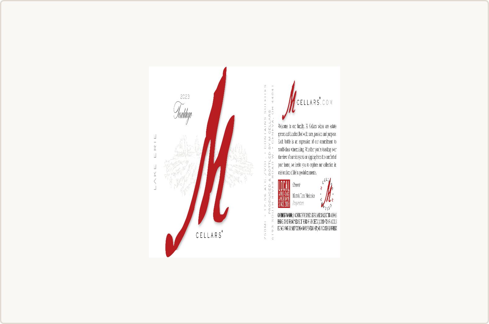
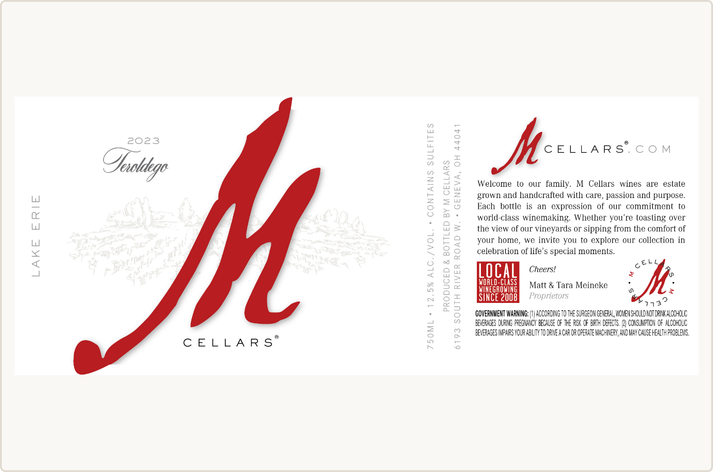
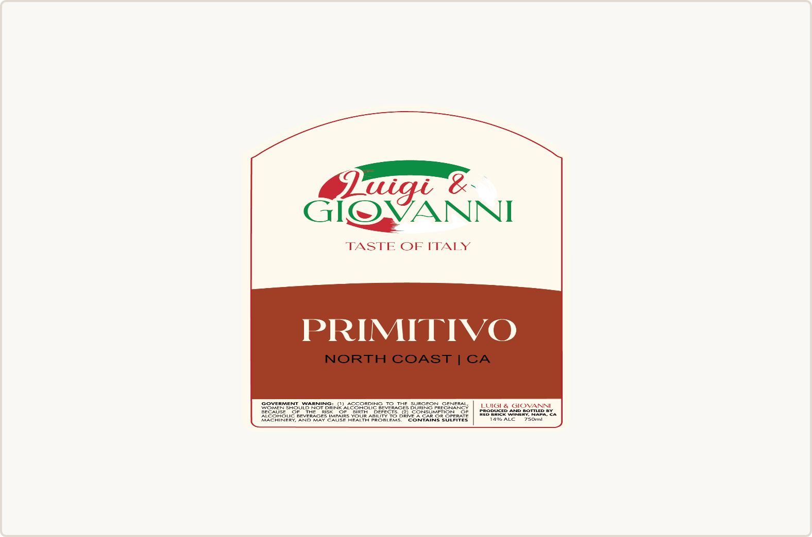
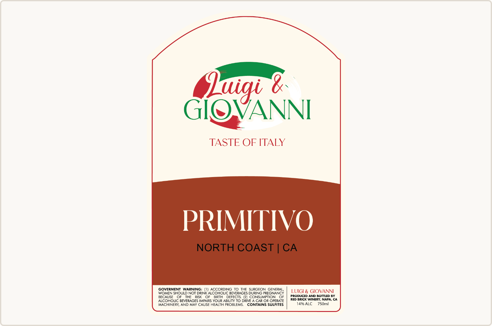

# Annotation canvas: draw label artwork at its real proportions

- Date: 2026-11-08
- Scope: the seller marking canvas on `/review` (`PackageAnnotationCanvas`)
- Baseline: `main` at `195182c`, local production build, Chromium, 1440×900 at device scale 2

## Defect

The canvas SVG box had the panel's aspect ratio, but its `viewBox="0 0 1 1"` with `preserveAspectRatio="xMidYMid meet"` fitted a square coordinate space inside it, and the image stretched to fill that square. Every label was therefore drawn as a square with empty bands beside or above it. Seller regions stayed correct relative to the image, because both shared the same square space, but sellers marked distorted artwork, and fine print such as the government warning became hard to read on wide labels.

Measured drawn width ÷ height of the image element:

| Fixture | File proportions | `main` | This change |
|---|---|---|---|
| `m-cellars-24205001000905/label-ocr-source.jpeg` | 2404 × 979 (2.456) | 1.000 | 2.456 |
| `approved-wine-001/label.png` | 975 × 1500 (0.650) | 1.000 | 0.650 |

## Change

The viewBox now has the panel's own proportions (`0 0 1 h/w`) and the image fills it, so the drawing space is uniformly scaled. Seller evidence is still stored as fractions of the panel on both axes; only drawing maps the vertical axis into the new space, and pointer input maps back. Marks, labels, and handles are sized from the panel's shorter side so they look the same as before.

## Before and after

| `main` | This change |
|---|---|
|  |  |
|  |  |

## Verification

- A browser test uploads both fixtures and requires the drawn image to match the file's proportions within 1%. It fails on `main` with an error of 1.456 on the landscape label and passes here. The same test draws a region at 25–75% across and 40–50% down the visible image and requires the saved region to be exactly those panel fractions.
- Unit tests check the viewBox and image size for portrait, landscape, and square panels, and that a stored region keeps its normalized value while being drawn in the new space.
