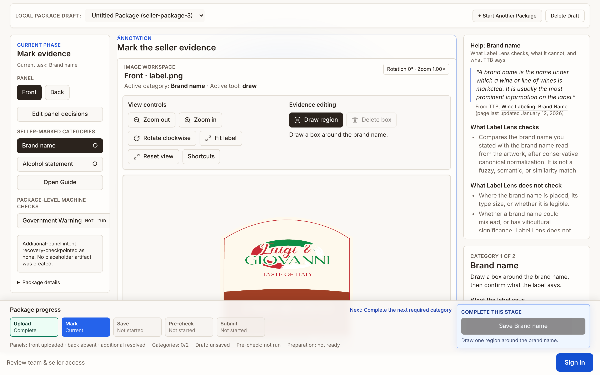
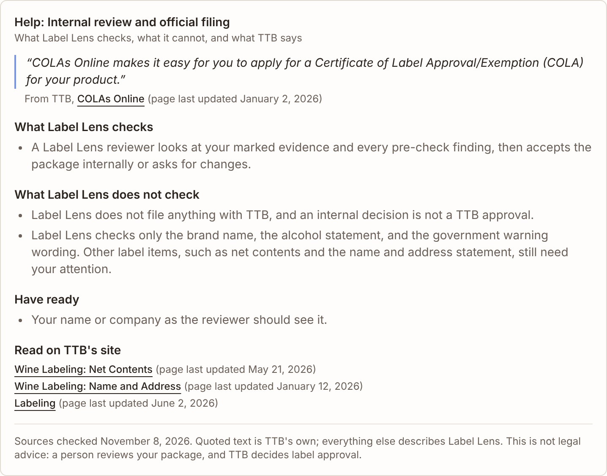
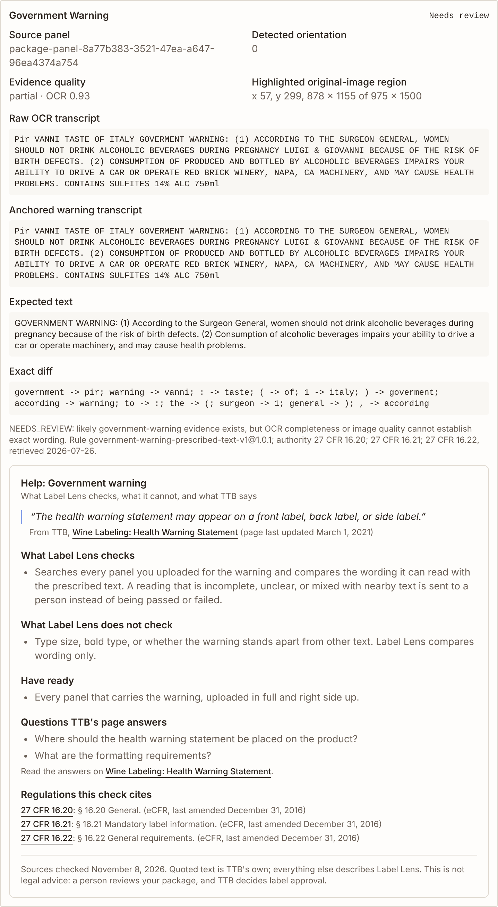
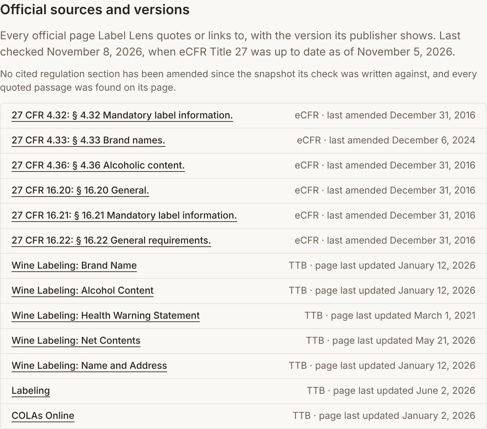

# Issue #226 Block 2: source-grounded help beside each applicant step

- Date: 2026-11-08
- Scope: the Help panel on `/review` (brand name, alcohol statement, government warning, final step) and the official-sources list on `/learn`
- Build: local production build of this branch, SQLite e2e seed, Chromium, 1440×900 at device scale 2; real OCR pre-check on `approved-wine-001`
- Design and process: [Applicant guidance and its official sources](../../applicant-guidance-sources.md)

## Evidence

Brand-name step with Help open beside the task. The panel's height is capped so the task stays in view below it.

Final step: the COLAs Online quote, an explicit "does not file with TTB" statement, and TTB pages for the label items Label Lens does not check.

Government-warning results with the matching help, which states that Label Lens compares wording only.

The `/learn` list of every official source with the version its publisher shows.

## Observations

- The live verification on 2026-11-08 matched all 13 sources, and all 13 quoted strings were found verbatim on their TTB pages.
- The panel follows the active task (brand name, then alcohol statement) and stays open across tasks once opened.
- A first placement below the sticky task card let the card cover the panel while scrolling, and a browser test caught it. The panel now sits above the card.
